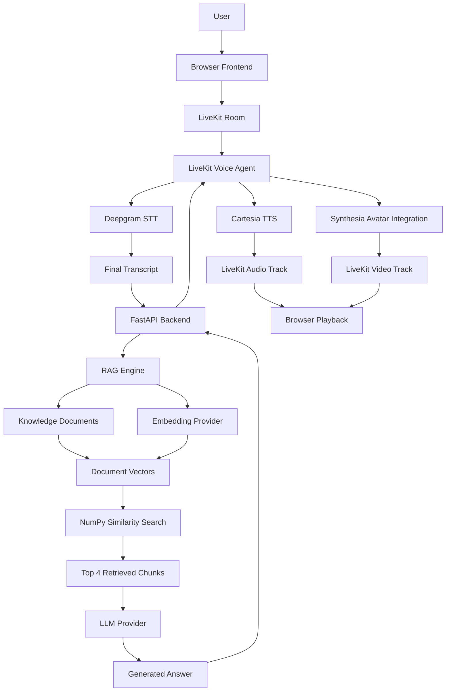

# Faris AI — Real-Time Voice-Powered AI Avatar

A real-time conversational AI application that combines voice interaction, Retrieval-Augmented Generation (RAG), LLM orchestration, speech synthesis, and AI avatar integration.

Faris AI allows users to interact with an AI assistant through their microphone. It processes spoken questions, retrieves relevant information from a knowledge base, generates contextual responses using an LLM, and delivers spoken answers through a real-time avatar experience.

The project brings together **LiveKit, FastAPI, Deepgram, NumPy, OpenAI-compatible LLM APIs, Cartesia, and Synthesia** in a single conversational pipeline.

---

## Table of Contents

- [Overview](#overview)
- [Key Features](#key-features)
- [System Architecture](#system-architecture)
- [How It Works](#how-it-works)
- [Technology Stack](#technology-stack)
- [Project Structure](#project-structure)
- [Understanding the RAG Pipeline](#understanding-the-rag-pipeline)
- [API Endpoints](#api-endpoints)
- [Getting Started](#getting-started)
- [Environment Configuration](#environment-configuration)
- [Running the Application](#running-the-application)
- [Testing the API](#testing-the-api)
- [Engineering Decisions](#engineering-decisions)
- [Current Limitations](#current-limitations)
- [Future Improvements](#future-improvements)
- [Contributing](#contributing)
- [License](#license)

---

## Overview

Traditional chatbots primarily rely on text-based interactions. Faris AI explores a different approach by combining conversational intelligence with real-time voice communication and an AI avatar.

The application is built around three major components:

1. **Voice Interaction:** Captures user speech and converts it into text.
2. **Knowledge-Based Intelligence:** Retrieves relevant information using RAG before generating an answer.
3. **Voice and Avatar Response:** Converts the generated answer into speech and integrates it with an AI avatar experience.

The objective is to understand how different AI services and backend components can work together to create a complete voice-based conversational application.

## Key Features

- Real-time voice interaction using LiveKit.
- Speech-to-Text using Deepgram Nova-3 through LiveKit Inference.
- FastAPI backend for question processing and orchestration.
- Retrieval-Augmented Generation using document embeddings.
- Markdown-based knowledge ingestion.
- Token-based text chunking using tiktoken.
- NumPy-based vector normalization and similarity search.
- Retrieval of the four most relevant knowledge chunks.
- Context-aware responses using conversation history.
- Multiple OpenAI-compatible LLM provider configurations with fallback support.
- Text-to-Speech using Cartesia Sonic.
- Synthesia avatar integration.
- Browser-based audio and video playback through LiveKit.
- Server-Sent Events (SSE) endpoint for streaming responses.

---

## System Architecture

The following diagram illustrates the major components and their communication flow.



**Architecture note:** The browser communicates with the LiveKit room for real-time media. The voice agent sends the recognized question to FastAPI over HTTP and receives the generated answer. Audio and video tracks are delivered to the browser through LiveKit.

---

## How It Works

The complete conversational lifecycle follows these steps:

**1. User connects to the application**

The browser requests a LiveKit access token from FastAPI and joins a LiveKit room.

**2. Microphone input**

The user enables their microphone and starts speaking.

**3. Speech recognition**

LiveKit transports the audio to the voice agent. Deepgram Nova-3 processes the speech through LiveKit Inference and produces a transcript.

**4. Backend request**

The agent waits for the final transcript and sends the question to:

`POST /api/avatar/ask`

The current room name is used as the conversation session identifier.

**5. Knowledge retrieval**

The RAG engine converts the question into an embedding and compares it with the precomputed knowledge vectors.

**6. Context construction**

The four most relevant knowledge chunks are combined with the system instructions and conversation history.

**7. LLM response generation**

The configured LLM provider generates a contextual response. If a supported provider failure occurs, another configured chat provider can be attempted.

**8. Voice generation**

The generated answer is returned to the LiveKit agent and passed to Cartesia TTS.

**9. Avatar integration**

The agent also integrates with Synthesia to provide the avatar experience.

**10. Browser playback**

LiveKit delivers the subscribed audio and video tracks to the browser, where the user can hear and see the response.

---

## Technology Stack

| Technology | Responsibility |
|---|---|
| Python | Core application and agent development |
| FastAPI | Backend APIs and request handling |
| LiveKit | Real-time audio/video communication |
| LiveKit Agents | Voice agent framework |
| Deepgram Nova-3 | Speech-to-Text |
| OpenAI Python SDK | OpenAI-compatible LLM and embedding API integration |
| NumPy | Vector normalization and similarity calculations |
| tiktoken | Token counting and document chunking |
| Cartesia Sonic | Text-to-Speech |
| Synthesia | AI avatar integration |
| HTML, CSS, JavaScript | Browser frontend |
| HTTPX | Asynchronous HTTP communication |
| Uvicorn | ASGI application server |

---

## Project Structure

```text
faris-avatar/
│
├── agent.py
│
├── server.py
│
├── rag.py
│
├── run_all.py
│
├── list_models.py
│
├── knowledge/
│   └── about_faris.md
│
├── static/
│   └── index.html
│
├── requirements.txt
│
├── .env.example
│
├── .gitignore
│
└── README.md
```

### File Responsibilities

| File / Directory | Description |
|---|---|
| `agent.py` | Implements the LiveKit voice agent, STT event handling, backend communication, TTS, and avatar integration. |
| `server.py` | Implements the FastAPI backend, application lifecycle, API endpoints, LiveKit token generation, and frontend serving. |
| `rag.py` | Handles knowledge loading, chunking, embeddings, retrieval, conversation history, LLM requests, and provider fallback. |
| `run_all.py` | Starts and monitors the FastAPI backend and LiveKit agent processes. |
| `list_models.py` | Lists available models from a configured OpenAI-compatible provider. |
| `knowledge/` | Contains Markdown knowledge documents used by the RAG pipeline. |
| `static/index.html` | Contains the browser interface and LiveKit client integration. |
| `requirements.txt` | Lists the Python dependencies. |
| `.env.example` | Provides an example of the required environment configuration. |

---

## Understanding the RAG Pipeline

Retrieval-Augmented Generation allows an LLM to generate answers using relevant external knowledge instead of relying only on its pretrained information.

Faris AI implements an in-memory vector retrieval pipeline.

### 1. Knowledge Loading

The application loads Markdown files from the `knowledge/` directory.

The current loader searches for top-level `.md` files.

### 2. Text Chunking

Large documents are divided into smaller chunks using `tiktoken`.

Current configuration:

| Parameter | Value |
|---|---:|
| Encoding | `cl100k_base` |
| Chunk size | 400 tokens |
| Chunk overlap | 50 tokens |
| Chunk step | 350 tokens |
| Retrieval Top K | 4 |

Overlapping chunks help preserve context across chunk boundaries.

### 3. Embedding Generation

An embedding provider converts document chunks into numerical vectors.

These vectors represent the semantic information contained in the text.

### 4. Vector Normalization

NumPy is used to normalize the embedding vectors.

Normalization allows dot-product similarity to represent cosine similarity.

### 5. Similarity Search

When a user asks a question:

- The question is converted into an embedding.
- The query vector is compared against the stored document vectors.
- NumPy calculates similarity scores.
- The four highest-scoring chunks are selected.

Conceptually:

```python
scores = _vectors @ query

best = np.argsort(scores)[::-1][:TOP_K]
```

### 6. Context Construction

The retrieved chunks are combined with the system prompt and conversation history.

The resulting context is passed to the configured LLM provider to generate the answer.

**Important:** The current implementation stores document vectors and conversation history in application memory. It does not use a persistent vector database.

---

## API Endpoints

The FastAPI backend currently exposes the following endpoints.

| Method | Endpoint | Purpose |
|---|---|---|
| `POST` | `/api/avatar/ask` | Processes a question through the RAG and LLM pipeline. |
| `POST` | `/api/avatar/ask/stream` | Provides a streaming question-answering endpoint using SSE. |
| `POST` | `/api/livekit/token` | Generates a LiveKit room access token. |

The browser uses the LiveKit token endpoint to join a room. The voice agent currently uses the non-streaming `/api/avatar/ask` endpoint.

---

## Getting Started

Follow these steps to run Faris AI locally.

### Prerequisites

Make sure you have:

- Python 3.12 recommended for the documented setup.
- pip.
- Git.
- A LiveKit account and project credentials.
- Deepgram access through LiveKit Inference.
- An OpenAI-compatible LLM and embedding provider.
- Cartesia credentials.
- Synthesia avatar configuration.

### Step 1: Clone the Repository

```bash
git clone https://github.com/Quasim12/faris-avatar.git

cd faris-avatar
```

### Step 2: Create a Virtual Environment

**Windows PowerShell:**

```powershell
python -m venv .venv

.\.venv\Scripts\Activate.ps1
```

**macOS / Linux:**

```bash
python3 -m venv .venv

source .venv/bin/activate
```

### Step 3: Install Dependencies

```bash
python -m pip install --upgrade pip

python -m pip install -r requirements.txt
```

### Step 4: Configure Environment Variables

Copy the example environment file.

**Windows PowerShell:**

```powershell
Copy-Item .env.example .env.local
```

**macOS / Linux:**

```bash
cp .env.example .env.local
```

Open `.env.local` and configure the credentials and settings required by the application.

See the [Environment Configuration](#environment-configuration) section below.

### Step 5: Start the Application

Run the process supervisor:

```bash
python run_all.py
```

This starts the FastAPI backend and LiveKit voice agent.

Open the local frontend URL printed by the application or configured in your environment.

---

## Environment Configuration

Faris AI uses environment variables to keep application configuration and external service credentials separate from source code.

Configure the variables documented in `.env.example`.

The configuration covers:

| Configuration Area | Purpose |
|---|---|
| LLM provider | API key, base URL, and chat model |
| Embedding provider | Embedding API credentials, URL, and model |
| Fallback providers | Optional alternative chat providers |
| LiveKit | Server URL, API key, and API secret |
| Synthesia | Avatar integration credentials and avatar configuration |
| Cartesia | Voice configuration and voice identifier |
| Backend | Backend URL and application settings |
| Conversation history | History message limit and session configuration |

The application also supports optional fallback LLM provider configurations.

**Security recommendations:**

- Never commit `.env.local` or actual API credentials.
- Keep `.env.example` limited to placeholder values.
- Rotate any credentials that have accidentally been exposed.
- Keep all service credentials on the backend.

---

## Running the Application

The application consists of two main processes:

**FastAPI Backend**

Responsible for:
- API requests.
- Knowledge base initialization.
- RAG processing.
- LLM communication.
- LiveKit token generation.
- Frontend serving.

**LiveKit Voice Agent**

Responsible for:
- Joining LiveKit rooms.
- Receiving microphone audio.
- Processing speech recognition events.
- Communicating with FastAPI.
- Generating spoken responses.
- Integrating with the avatar session.

`run_all.py` supervises both processes. If either process exits, the supervisor stops the other process. It does not automatically restart a crashed process.

---

## Testing the API

After starting the backend, you can verify the available endpoints.

### Check API Documentation

Open:

```text
http://localhost:8000/docs
```

Use the actual backend port configured in your environment if it differs from `8000`.

### Generate a LiveKit Token

Endpoint:

```http
POST /api/livekit/token
```

Example request:

```json
{}
```

The backend generates a room access token and returns the connection information required by the browser.

### Ask a Question

Endpoint:

```http
POST /api/avatar/ask
```

Example request body:

```json
{
  "question": "What is Faris AI?",
  "sessionId": "demo-session-001"
}
```

The response contains the generated answer.

The exact response structure is defined by the backend implementation.

---

## Engineering Decisions

A few implementation decisions are worth highlighting.

### 1. Separate Voice Processing from RAG Logic

The LiveKit agent handles real-time voice interaction, while FastAPI and the RAG module handle question answering.

This separation keeps the responsibilities easier to understand and maintain.

### 2. In-Memory Vector Retrieval

NumPy provides a straightforward way to perform vector normalization and similarity calculations without introducing a dedicated vector database.

This keeps the initial implementation lightweight.

### 3. Conversation History

Conversation messages are maintained in memory using session identifiers.

The default configuration keeps the latest 12 message objects per session, with a limit of 200 session histories.

### 4. LLM Provider Fallback

The application supports a primary chat provider and optional alternative providers.

Handled failures such as rate limits, authentication errors, and temporary provider issues can trigger fallback behavior.

### 5. Real-Time Media Through LiveKit

LiveKit handles browser-to-agent audio communication and delivery of subscribed audio/video tracks.

The application uses HTTP separately for communication between the agent and FastAPI.

---

## Current Limitations

The project is an implementation-focused application and has some limitations that are important to understand.

- Knowledge vectors are stored in memory and are regenerated when the backend restarts.
- Conversation history is not persisted in a database.
- Retrieval currently selects the top four chunks without a configurable relevance threshold or reranking stage.
- The current knowledge loader searches top-level Markdown files rather than recursively scanning nested folders.
- LLM fallback is implemented for chat providers; embedding generation does not have the same provider fallback mechanism.
- The SSE endpoint exists, but the current LiveKit agent uses the regular question-answering endpoint.
- The process supervisor stops both processes when either one exits; automatic crash recovery is not implemented.
- Avatar startup failures are handled so that the voice agent can continue in voice-only mode.

These are useful areas for further engineering improvements.

---

## Future Improvements

Potential next steps for evolving Faris AI include:

- Persistent vector storage using a dedicated vector database.
- Persistent conversation history using PostgreSQL or Redis.
- Configurable retrieval relevance thresholds.
- Hybrid search combining semantic and keyword retrieval.
- Reranking retrieved knowledge chunks.
- Query rewriting for better follow-up question retrieval.
- Improved observability, structured logging, and tracing.
- Automated tests for the complete voice-to-answer lifecycle.
- Process health monitoring and automatic recovery.
- Performance and latency optimization across STT, RAG, LLM, and TTS.

---

## Contributing

Contributions, suggestions, and discussions are welcome.

If you would like to improve the project:

1. Fork the repository.
2. Create a feature branch.
3. Implement your changes.
4. Test the changes locally.
5. Open a Pull Request with a clear explanation.

For larger changes, consider opening an issue first to discuss the proposed implementation.

---

## License

A license has not yet been specified for this repository. Please contact the repository owner before reusing or distributing the project.

---

## Connect

Interested in discussing Generative AI, RAG, LLM applications, AI agents, or real-time voice applications?

- **GitHub:** https://github.com/Quasim12
- **LinkedIn:** https://www.linkedin.com/in/md-kasim-459910193/
- **Medium:** https://medium.com/@mohammadkasim_57228
- **Topmate:** https://topmate.io/mohammad_kasim12/

You can also book a 1:1 session to discuss AI engineering, project architecture, and implementation.

---

**Faris AI — Connecting Voice, Knowledge, and Conversational Intelligence.**
